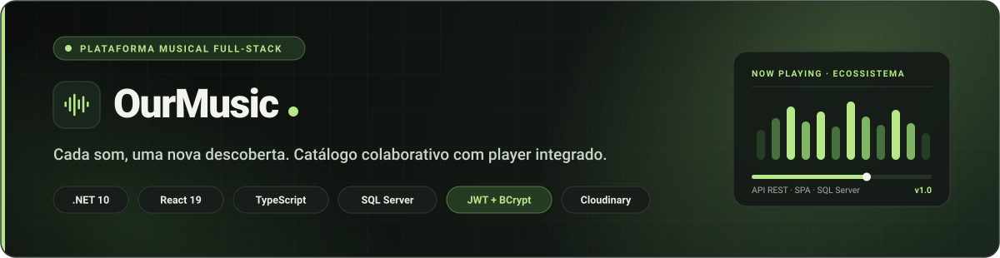

  

  
  
  
  
  
  

---

### Sobre a OurMusic

A **OurMusic** desenvolve uma plataforma web **Full-Stack** de catálogo musical colaborativo com reprodução integrada via YouTube. O projeto une engenharia de dados relacional, arquitetura em camadas contratuais com autenticação blindada e uma interface escura responsiva fiel ao nosso Design System no Figma.

---

### Arquitetura do Ecossistema

| Camada | Tecnologias | Responsabilidades |
| :--- | :--- | :--- |
| **Banco de Dados** | SQL Server 2022 · T-SQL · Docker | 5 tabelas (`Usuario`, `Musica`, `Genero`, `MusicaGenero` N:N e `Comentario`), constraints `CHECK`/`UNIQUE`, índices e Trigger de exclusão lógica (`TR_UsuarioSoftDelete`). |
| **Backend (API REST)** | ASP.NET Core (.NET 10) · EF Core · Swagger | Arquitetura em camadas contratuais (`Interfaces`, `Repositories`, `DTOs`, `Services`, `Controllers`), autenticação **JWT** com validação em tempo real (`OnTokenValidated`), revogação de sessão no logout, **BCrypt** com auto-migração e upload de capas no **Cloudinary** com rollback seguro. |
| **Frontend (SPA)** | React 19 · TypeScript · Vite · Axios | Interface responsiva baseada no **Figma**, Interceptors globais de autenticação, `AuthProvider`, `ProtectedRoute`, player fixo persistente com **YouTube IFrame API** e painel administrativo completo. |

---

### Principais Funcionalidades

- **Catálogo interativo e descoberta:** destaque editorial, busca por título, filtros por gênero musical, paginação e grade responsiva.
- **Reprodutor global integrado:** barra fixa de áudio/vídeo via YouTube IFrame API com fila, modo aleatório, repetir, controle de volume e janela PiP que continua tocando durante a navegação.
- **Gestão colaborativa e comentários:** qualquer usuário autenticado pode cadastrar músicas (com upload de capa no Cloudinary ou URL), ler letras e comentar nas faixas.
- **Controle de acesso e administração:** perfis `Usuario` e `Admin`, gerenciamento de músicas, gêneros e usuários com exclusão lógica (*Soft Delete*) e proteção contra auto-desativação.
- **Segurança de ponta a ponta:** senhas com hash **BCrypt**, tokens **JWT** revogáveis em tempo real no logout e segredos protegidos fora do repositório via `dotnet user-secrets` e `.env.local`.

---

### Repositório Principal e Design

- **[OurMusic/OurMusic](https://github.com/OurMusic/OurMusic)** — Código-fonte completo do Banco de Dados (`OurMusicDB.sql`), Backend (`OurMusic.WebAPI`) e Frontend (`React + TypeScript`).
- **[Protótipo Visual no Figma](https://www.figma.com/design/RdQtqDqQx5fwPlnANq7BMi/OurMusic?node-id=0-1)** — Design System, tokens de cor e telas oficiais da plataforma.

---

### Equipe

<table>
  <tr>
    <td align="center">
      <a href="https://github.com/caiohbdasilva">
         
        <b>Caio Henrique</b>
      </a> 
      <code>@caiohbdasilva</code>
    </td>
    <td align="center">
      <a href="https://github.com/TK-Eric">
         
        <b>TK-Eric</b>
      </a> 
      <code>@TK-Eric</code>
    </td>
  </tr>
</table>

---

  <b>OurMusic</b> · Cada som, uma nova descoberta.

